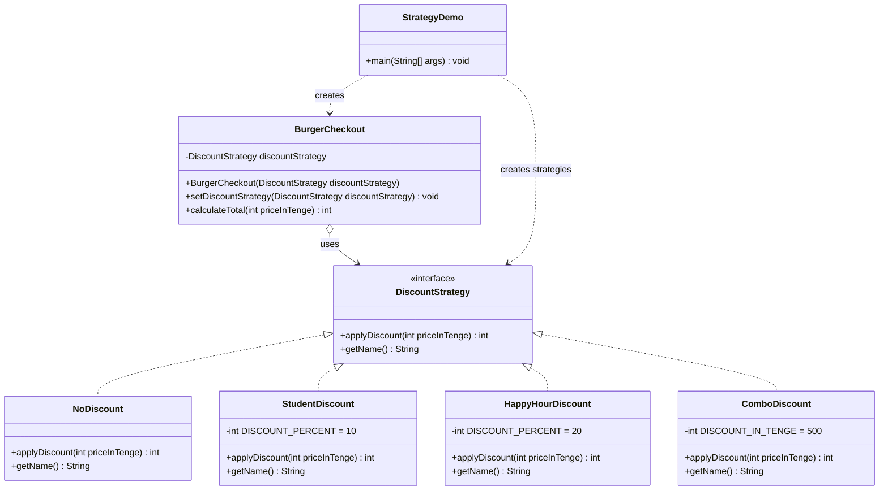

# Assignment 5 — Strategy Pattern

## 1. Introduction

My project is a burger ordering system. In this assignment I added discounts for a burger order. There are four ways to calculate the price: no discount, a student discount (10% off), a happy hour discount (20% off) and a combo discount (500 tenge off). These four ways are a family of algorithms, so I used the Strategy Pattern: each discount is a separate class, and the checkout can change the discount while the program is running.

## 2. UML Class Diagram



| Role | Class |
|------|-------|
| Strategy | DiscountStrategy |
| Concrete Strategy | NoDiscount, StudentDiscount, HappyHourDiscount, ComboDiscount |
| Context | BurgerCheckout |
| Client | StrategyDemo |

## 3. Clean Code Principles

### 3.1 Replace if/switch with polymorphism (Chapter 10)

Without the pattern, one method must check the discount type with a `switch`. Every new discount means changing this method again. With the Strategy Pattern, the checkout just calls the strategy, and each class knows its own rule.

BEFORE (only an example, this code is not in the project):

```java
public int calculateTotal(int price, String discountType) {
    switch (discountType) {
        case "STUDENT":    return price * 90 / 100;
        case "HAPPY_HOUR": return price * 80 / 100;
        case "COMBO":      return Math.max(0, price - 500);
        default:           return price;
    }
}
```

AFTER (`BurgerCheckout`):

```java
public int calculateTotal(int priceInTenge) {
    return discountStrategy.applyDiscount(priceInTenge);
}
```

### 3.2 Meaningful names (Chapter 2)

Names say what things are, so the reader does not need comments. The price is called `priceInTenge`, so the unit is clear. The numbers 10, 20 and 500 are named constants, not "magic numbers".

```java
private static final int DISCOUNT_PERCENT = 10;

public int applyDiscount(int priceInTenge) {
    return priceInTenge * (100 - DISCOUNT_PERCENT) / 100;
}
```

### 3.3 Small classes and Single Responsibility (Chapter 10)

Each class is small and has only one reason to change. `StudentDiscount` changes only if the student rule changes. `BurgerCheckout` does not calculate any discount itself.

```java
public class ComboDiscount implements DiscountStrategy {
    private static final int DISCOUNT_IN_TENGE = 500;

    @Override
    public int applyDiscount(int priceInTenge) {
        return Math.max(0, priceInTenge - DISCOUNT_IN_TENGE);
    }
    ...
}
```

### 3.4 Open/Closed Principle — Organizing for Change (Chapter 10)

The code is open for new discounts but closed for changes. I added `ComboDiscount` as the last strategy. I did not change the interface, `BurgerCheckout` or the other strategies. I only wrote one new class and added one line in `StrategyDemo`.

```java
List<DiscountStrategy> strategies = List.of(
        new NoDiscount(),
        new StudentDiscount(),
        new HappyHourDiscount(),
        new ComboDiscount()      // the new discount
);
```

### 3.5 Dependency Injection — separate construction from use (Chapter 11)

`BurgerCheckout` does not create its strategy. It gets the strategy from outside, through the constructor or `setDiscountStrategy`. Only the client (`StrategyDemo`) creates objects. A `null` strategy is rejected at once with a clear message.

```java
public BurgerCheckout(DiscountStrategy discountStrategy) {
    this.discountStrategy = requireDiscountStrategy(discountStrategy);
}

public void setDiscountStrategy(DiscountStrategy discountStrategy) {
    this.discountStrategy = requireDiscountStrategy(discountStrategy);
}
```

### 3.6 Clean tests — one concept per test, F.I.R.S.T. (Chapter 9)

Every test checks one idea, and its name says the method, the condition and the result. The tests are Fast, Independent, Repeatable, Self-validating (they use asserts, no console output) and Timely. They do not depend on the order in which they run.

```java
@Test
void calculateTotal_afterSetDiscountStrategy_usesNewStrategy() {
    BurgerCheckout checkout = new BurgerCheckout(new NoDiscount());

    checkout.setDiscountStrategy(new HappyHourDiscount());

    assertEquals(800, checkout.calculateTotal(1000));
}

@Test
void applyDiscount_priceBelow500_returns0() {
    assertEquals(0, discount.applyDiscount(300));
}
```

## 4. Conclusion

The Strategy Pattern made the discount code flexible. I can add a new discount or change the discount at runtime without touching the old classes, and there is no long `switch`. The downside is that there are more classes: one class for every discount. For a small project with only one or two simple rules, a `switch` could be enough, but when rules grow, Strategy keeps the code clean and easy to test.

## 5. GitHub Link

https://github.com/vuus1d/burgerNR
